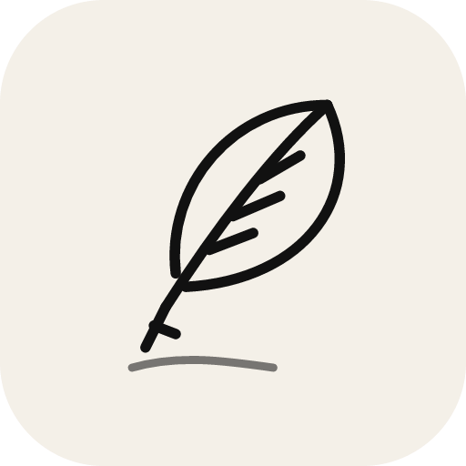

<p align="center">
  
</p>

<h1 align="center">Plume</h1>

<p align="center">A quiet, Apple-style journal for your Mac.<br/>Write, speak, attach photos, see your month at a glance.</p>

---

## What it does

- **Write** in a calm, uncluttered editor with mood, tags, places and photos. Entries autosave.
- **Speak** instead of typing. Three options: your Mac's built-in dictation, on-device Whisper (private, downloads a model once), or the OpenAI transcription API with your own key. The audio clip is kept with the entry.
- **Photos and videos** are thumbnailed locally. If a photo carries GPS data, Plume asks whether to use it as the entry's place.
- **Places** on Apple Maps. On a Mac the app renders real Apple Maps through the system MapKit framework (no developer token needed), searches places with Apple's local search and reverse-geocodes with CoreLocation. Every place also opens in the Apple Maps app. MapKit JS is used instead when you add a token; other platforms fall back to OpenStreetMap.
- **Insights**: today's words and streak, a 30‑day activity grid with a comparison against the previous 30 days, words per week, mood over time, when you tend to write, the places you've been, top tags and words.
- **Storage you control.** Text always stays on your Mac. Photos and recordings live in a folder you pick, or in your own Google Drive so your laptop stays light. Switching providers migrates existing files.
- **Fonts.** Pick a built-in typeface, type any installed font's name, or import a `.ttf` / `.otf` / `.woff` file.
- **Avatars**: Apple people emoji with skin tones, a build-a-person maker (hair, eyes, eyebrows, mouth, skin, glasses, beard, clothes, built on the free Avataaars set), or an uploaded picture such as a Memoji sticker.
- **Accounts** are local: each person on the Mac gets their own journal, protected by a password (bcrypt). Nothing is sent anywhere unless you connect Google Drive or OpenAI.
- English, 简体中文 and 繁體中文. Light and dark, following the system.

## Requirements

- macOS 13 or later (Apple Silicon or Intel)
- Node.js 20+ and the Xcode Command Line Tools (`xcode-select --install`) to run from source

## Run from source

```bash
npm install
npm run dev
```

Build a DMG:

```bash
npm run dist:dmg
```

The bundle is unsigned. On first launch, right‑click the app and choose **Open**.

## Google Drive

Plume talks to Drive directly from your Mac with the `drive.file` scope, which only grants access to files Plume creates.

1. Go to [Google Cloud Console](https://console.cloud.google.com/apis/credentials) and create a project.
2. **APIs & Services › Library**: enable the *Google Drive API*.
3. **OAuth consent screen**: External, add yourself as a test user.
4. **Credentials › Create credentials › OAuth client ID**: application type *Desktop app*.
5. In Plume, open **Settings › Storage**, paste the client ID and secret, then **Connect**.

Your tokens are encrypted with macOS Keychain (`safeStorage`) and never written in plain text.

## Apple Maps

On macOS, maps are rendered natively by a small Swift helper (`native/plume-maps`, built automatically before `npm run dev` / `npm run build`; needs the Xcode Command Line Tools). No account or token is required.

For the fully interactive MapKit JS map, add a token: maps inside the app use MapKit JS when a token is present. Create one under **Certificates, Identifiers & Profiles › Keys › Maps IDs** in your [Apple Developer account](https://developer.apple.com/account/resources/services/maps-tokens) and paste it into **Settings › Maps**. Without a token Plume falls back to an OpenStreetMap basemap; the "Open in Apple Maps" link works either way.

## Voice

- **Built-in dictation**: press the 🎤 key (or fn twice) while writing. No setup.
- **On this Mac**: Whisper runs locally through `@huggingface/transformers` in a Web Worker (WebGPU when available, WASM otherwise). The first use downloads a model: tiny ≈ 40 MB, base ≈ 80 MB, small ≈ 250 MB.
- **OpenAI**: paste an API key in **Settings › Voice**; audio is sent from the main process so the key never reaches the UI.

## Where your data lives

| What | Where |
| --- | --- |
| Entries, accounts, settings | `~/Library/Application Support/Plume/` |
| Photos and recordings (local mode) | `~/Documents/Plume Journal/` by default |
| Thumbnails and Drive cache | `~/Library/Application Support/Plume/users/<id>/` |
| Imported fonts | `~/Library/Application Support/Plume/fonts/` |

## Development

```bash
npm run typecheck   # main + renderer
npm test            # insight maths
npm run icon        # regenerate build/icon.icns from build/icon.svg
```

Stack: Electron 33, electron-vite, React 18, Tailwind CSS 4, motion, MapKit (Swift helper), Leaflet, transformers.js, DiceBear Avataaars.

## 中文說明

Plume 是一款安靜的 macOS 日記 App。文字永遠留在你的 Mac 上；照片和錄音可以放在本機資料夾或你自己的 Google Drive。支援語音輸入（系統聽寫、本機 Whisper 或 OpenAI）、照片地點、原生 Apple 地圖（不需要開發者帳號）、日曆與特別的日子、30 天寫作洞察、自訂字體、自訂人物頭像，以及本機帳號登入。介面支援繁體中文、简体中文與英文。

從原始碼執行：`npm install` 之後 `npm run dev`；打包 DMG：`npm run dist:dmg`。

## License

MIT
